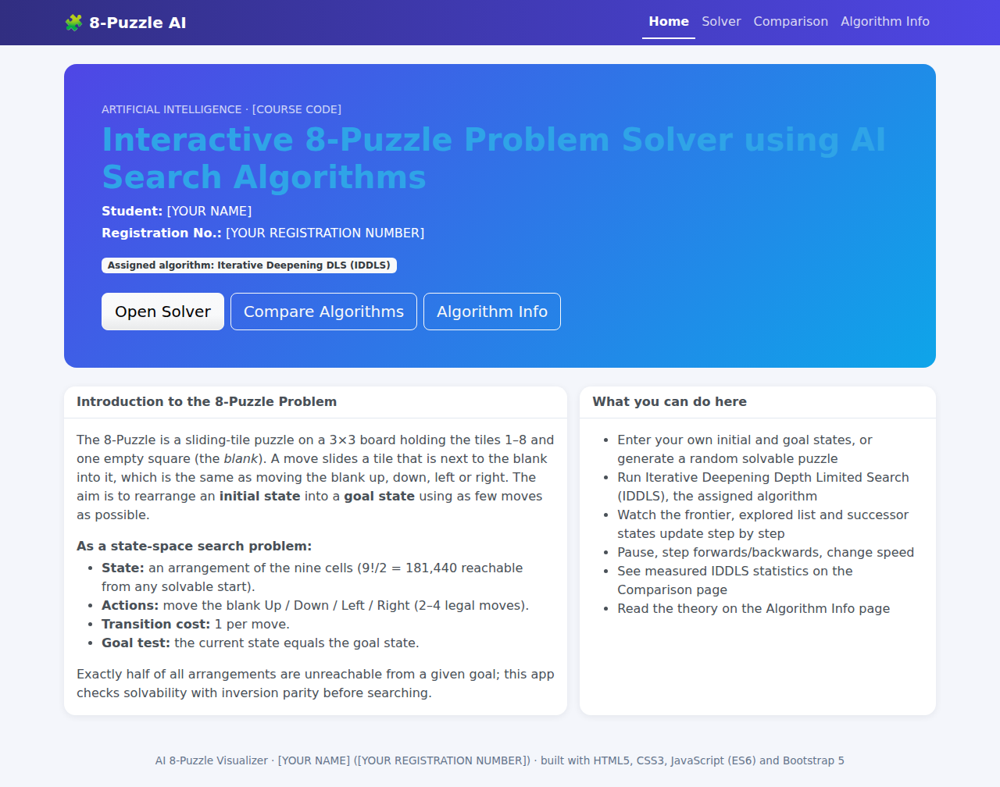
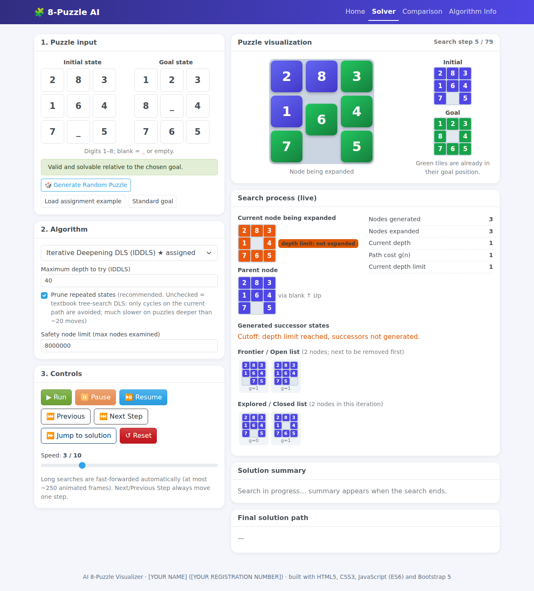
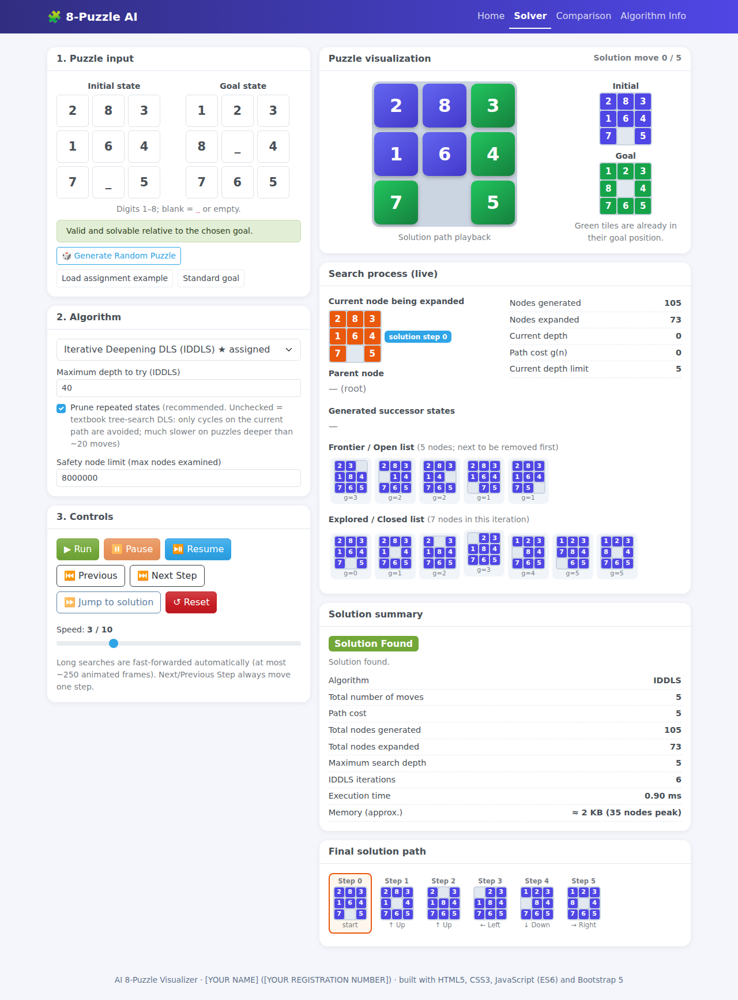
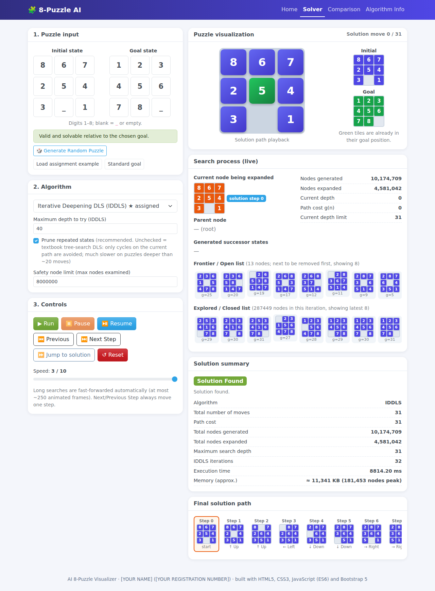
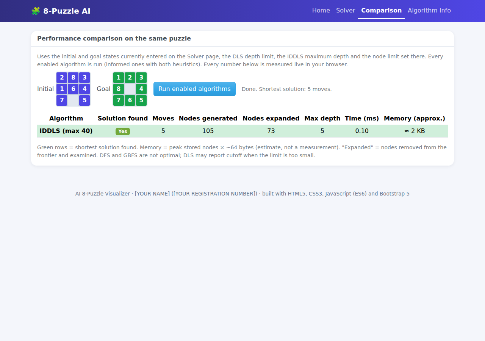
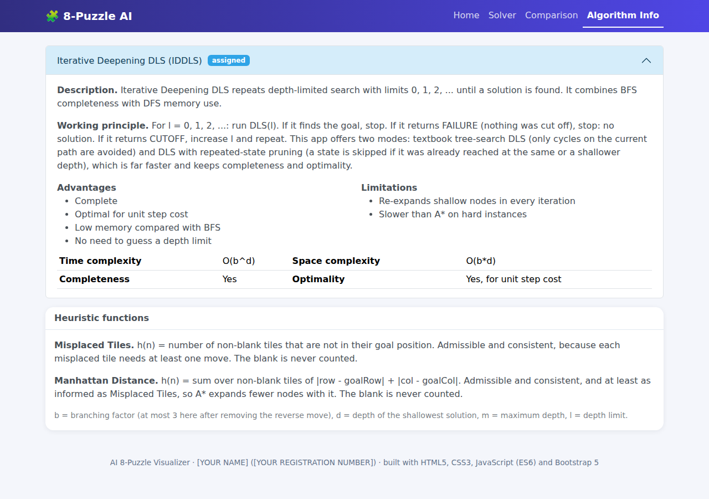

# AI-8Puzzle-Visualizer

Interactive 8-Puzzle solver that visualizes classic uninformed and informed search algorithms. Built for the *Artificial Intelligence* digital assignment (case study). Pure static site: **no backend, no build step, no paid APIs.**

## Student Details
| | |
|---|---|
| Name | **[YASHASHWINI SIWACH]** |
| Registration No. | **[24BCI0159]** |
| Course | Artificial Intelligence – [BCSE306L] |
| Assigned algorithm | Algorithm No. 4 – Iterative Deepening Depth Limited Search (IDDLS) |
| GitHub repository | https://github.com/YashashwiniSiwach26/AI-8Puzzle-Visualizer |
| Live site (GitHub Pages) | https://YashashwiniSiwach26.github.io/AI-8Puzzle-Visualizer |


## Project Description
The app models the 8-Puzzle as a state-space search problem (state = 3×3 arrangement, action = move the blank, unit cost, goal test = equals goal). You can enter any initial and goal state or generate a random solvable puzzle, choose an algorithm, and watch it search: the current node, generated successors, frontier (open list), explored (closed list), depth, parent, g(n), h(n), f(n) are shown live, and the blank-tile movement is animated. A comparison page runs every algorithm on the same puzzle and reports measured statistics.

## Technologies Used
HTML5 · CSS3 · JavaScript (ES6, vanilla) · Bootstrap 5.3 (CDN). All search algorithms are implemented from scratch (no search libraries). Tests run with plain Node.js (no packages).

## Search Algorithm Implemented
Per the assignment table, this project's assigned algorithm is **No. 4 – IDDLS**, and it is the only algorithm enabled in the app (`enabledAlgorithms: ['iddls']` in `js/config.js`).

The `js/algorithms.js` file is written as a general engine, so it still contains the code for the other six algorithms (they are used by `tests/run-tests.js` to cross-check IDDLS's optimality against BFS/A*). They are not exposed in the interface. If your teacher wants the other code removed from the repository, delete those branches from `algorithms.js` and the matching tests.

Full set available in the engine:

| Algorithm | Type | Notes |
|---|---|---|
| Breadth First Search (BFS) | Uninformed | FIFO queue + closed set; optimal for unit cost |
| Depth First Search (DFS) | Uninformed | LIFO stack + closed set; not optimal, paths can be very long |
| Depth Limited Search (DLS) | Uninformed | Distinguishes **cutoff** (limit hid part of the space) from **failure** |
| Iterative Deepening DLS (IDDLS) | Uninformed | Limits 0,1,2,…; complete and optimal for unit cost |
| Uniform Cost Search (UCS) | Uninformed | Priority queue on g(n) |
| Greedy Best First Search (GBFS) | Informed | Priority queue on h(n) |
| A* Search | Informed | Priority queue on f(n)=g(n)+h(n) |

The Comparison page runs the enabled algorithm(s) on the current puzzle and reports measured statistics.

## IDDLS: how it works here
For limit L = 0, 1, 2, … run a depth-limited search; stop when the goal is found. A pass ends as **cutoff** (the limit hid part of the space, so raise L) or **failure** (space exhausted, no solution). Because L grows by one and moves cost 1, the first solution found is a shortest one.

Two modes (checkbox *Prune repeated states* on the Solver page):
- **Pruned (default, recommended):** a state is skipped if it was already reached in the same pass at the same or a shallower depth. Still complete and optimal, and solves every puzzle.
- **Textbook tree search (unchecked):** only cycles along the current path are avoided. Exactly the classic definition, but much slower: puzzles deeper than ~20 moves need millions of expansions.

Measured with the real code (Node 22, trace on): a 5-move puzzle takes <1 ms; the hardest 8-puzzle instance (`867254301` → `123456780`, 31 moves) is solved in ~10–17 s, expanding 4,581,042 nodes over 32 iterations, and its length matches BFS. Very long searches are fast-forwarded in the animation (a few hundred frames) and, to save browser memory, the animation of the earliest iterations may be dropped; the totals always count every iteration.

## Heuristics Used
(Provided in the engine; used by GBFS/A*, which are not enabled in this build. Delete this section if your teacher does not want it.)
- **Misplaced Tiles** – number of non-blank tiles not in their goal cell.
- **Manhattan Distance** – sum of row+column distances of each non-blank tile to its goal cell.

Both ignore the blank, work with any custom goal state, and are admissible and consistent.

## Features
Home page · editable initial/goal grids with validation · solvability check relative to the chosen goal (inversion parity) · random solvable puzzle · animated board · live search panels · Run / Pause / Resume / Next Step / Previous Step / Jump to solution / Reset / speed slider · solution summary (status, moves, generated, expanded, max depth, time, path cost, approximate memory) · comparison table · algorithm information page · responsive layout.

### Metric definitions (be ready to explain these in the demo)
- **Expanded**: nodes removed from the frontier and examined (goal test + successor generation).
- **Generated**: every successor created, including duplicates that are discarded.
- **Memory (approx.)**: peak number of stored nodes (frontier + closed/visited) × ~64 bytes. This is an estimate, not a measurement.
- **Node limit**: a safety cap (default 8,000,000 examined nodes). If hit, the status is *Stopped: node limit reached* (inconclusive), never "failure".

## Project Structure
```
AI-8Puzzle-Visualizer/
├── index.html          # all pages (Home, Solver, Comparison, Algorithm Info)
├── css/style.css
├── js/
│   ├── config.js       # YOUR details + which algorithms are enabled
│   ├── puzzle.js       # state model, validation, solvability, heuristics, random puzzle
│   ├── algorithms.js   # the 7 search algorithms (+ trace recording)
│   ├── info.js         # text for the Algorithm Info page
│   └── app.js          # UI controller
├── tests/              # run-tests.js (algorithms), ui-smoke.js (UI logic)
├── docs/               # TESTING.md, DEMO_SCRIPT.md, recorded test output
├── assets/  images/    # screenshots go in images/
└── README.md
```

### Enabling other algorithms
Edit `enabledAlgorithms` in `js/config.js`; the selector, comparison table and info page adapt automatically.

## How to Run the Project
**Locally:** download/unzip, then open `index.html` in a browser (internet needed once for the Bootstrap CDN). Or run a local server: `python3 -m http.server 8000` and visit http://localhost:8000.
**Tests:** `node tests/run-tests.js` (67 tests) and `node tests/ui-smoke.js` (Node 16+).

## Deploying to GitHub Pages
1. Create a new **public** repository named `AI-8Puzzle-Visualizer` on github.com (no README/licence, keep it empty).
2. Upload the *contents* of this folder (so `index.html` is at the repo root): on the new repo page click **uploading an existing file**, drag in everything (including the `css`, `js`, `tests`, `docs`, `images`, `assets` folders and `.nojekyll`), then **Commit changes**.
   Or with git: `git init && git add . && git commit -m "8-puzzle visualizer" && git branch -M main && git remote add origin https://github.com/YashashwiniSiwach26/AI-8Puzzle-Visualizer && git push -u origin main`
3. Go to **Settings → Pages**. Under *Build and deployment* choose **Source: Deploy from a branch**, **Branch: main**, folder **/ (root)**, then **Save**.
4. Wait 1–2 minutes and refresh. The URL appears at the top: `https://YashashwiniSiwach26.github.io/AI-8Puzzle-Visualizer/`
5. Open it and check every page works, then copy both URLs into your submission PDF.

## Screenshots
Captured from the running app in headless Chromium (retake them from your live GitHub Pages site if you want your name and the final look in them):

| | |
|---|---|
|  |  |
|  |  |
|  |  |


# AI-8Puzzle-Visualizer

